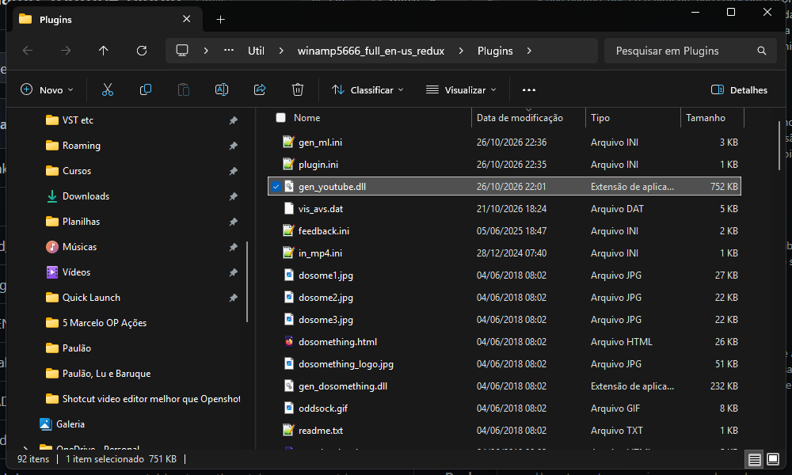
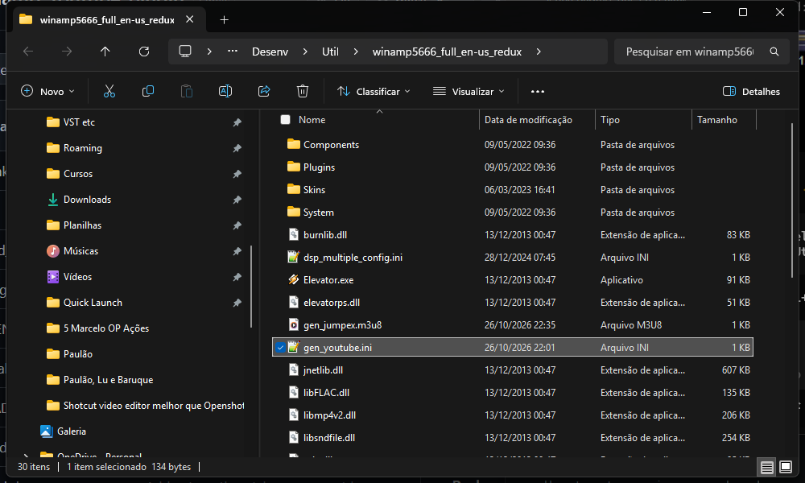
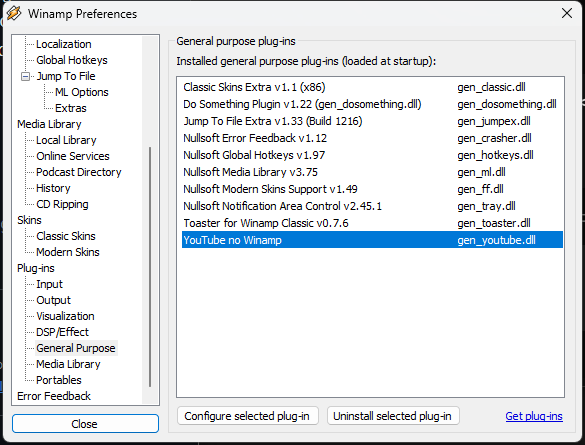
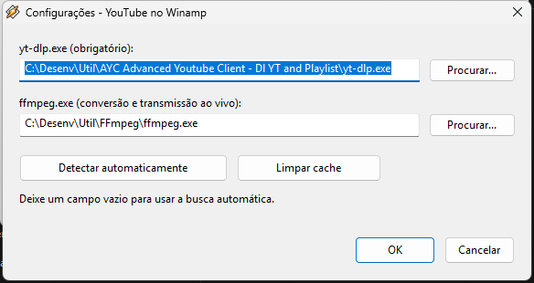
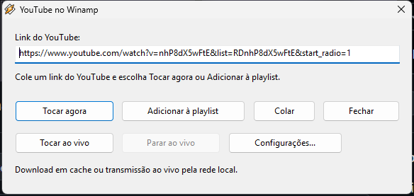
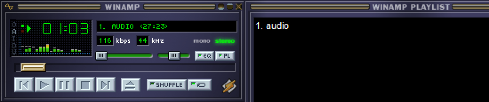
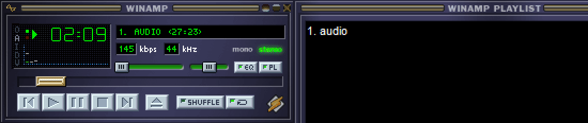

# YouTube no Winamp

Plugin de propósito geral para Winamp 5 (32 bits) que baixa o áudio de links do
YouTube com o `yt-dlp`, baixa playlists completas e transmite áudio ao vivo por
um relay HTTP local.

## Requisitos

- Winamp 5.x 32 bits
- `yt-dlp.exe` (obrigatório)
- `ffmpeg.exe` (necessário para converter WebM/Opus/MKA e para transmissão ao vivo)

O `yt-dlp` pode ficar:

- na pasta do `winamp.exe`;
- na pasta `Plugins`;
- em qualquer pasta do `PATH`;
- ou em um caminho escolhido em **Configurações**.

Baixe em <https://github.com/yt-dlp/yt-dlp/releases/latest>.
Em Windows de 32 bits, use `yt-dlp_x86.exe` e informe esse caminho em
Configurações. Para o `ffmpeg`, use uma build do
<https://www.gyan.dev/ffmpeg/builds/> ou
<https://github.com/BtbN/FFmpeg-Builds/releases>.

## Instalação

1. Compile ou use a DLL pronta em `build/gen_youtube.dll`.
2. Copie `gen_youtube.dll` para a pasta `Plugins` do Winamp, por exemplo:
   `C:\Program Files (x86)\Winamp\Plugins`.
3. Reinicie o Winamp.

## Uso

Abra a janela do plugin de uma destas formas:

- **Arquivo > Abrir link do YouTube...**
- clique com o botão direito no Winamp > **Abrir link do YouTube...**
- atalho **Ctrl+Alt+Y**
- **Preferências > Plug-ins > Propósito geral > YouTube no Winamp > Configurar**

Cole o link e escolha:

- **Tocar agora**: limpa a playlist, adiciona o áudio e inicia a reprodução.
- **Adicionar à playlist**: apenas enfileira.
- **Tocar ao vivo**: inicia a transmissão ao vivo por um servidor local.
- **Parar ao vivo**: encerra a transmissão atual.

A transmissão ao vivo também pode ser encerrada por
**Arquivo > Parar transmissão ao vivo** ou pelo menu de contexto do Winamp.

Links aceitos: `youtube.com`, `www.youtube.com`, `m.youtube.com`,
`music.youtube.com`, `youtu.be` e `youtube-nocookie.com`.

Para baixar uma playlist inteira, use o link da playlist
(`youtube.com/playlist?list=...`). Links normais de vídeo continuam baixando
somente aquele vídeo, mesmo que tenham `&list=` na URL.

O primeiro play de um vídeo baixa o áudio e pode demorar alguns segundos. Depois
o arquivo fica em cache em `%TEMP%\WinampYouTube`. Playlists completas podem
demorar bem mais e só ficam marcadas como completas depois que todos os itens
forem baixados e convertidos.

### Transmissão ao vivo

O plugin executa `yt-dlp` e `ffmpeg` em segundo plano e publica o MP3 em
`http://127.0.0.1:<porta>/live.mp3`, que é enviado ao Winamp. A porta é escolhida
automaticamente e aceita apenas conexões da própria máquina.

O `ffmpeg.exe` é obrigatório para transmissão ao vivo. A transmissão continua
ativa depois que a janela do plugin fecha; use **Parar ao vivo** ou o menu do
Winamp para encerrá-la.

## Capturas de tela

Capturas feitas com a interface clássica do Winamp 5.666; a skin moderna
original foi restaurada depois. Veja também
[`docs/screenshots/README.md`](docs/screenshots/README.md).

### Instalação e configuração









### Uso







## Configurações

O botão **Configurações...** permite:

- localizar `yt-dlp.exe` e `ffmpeg.exe`;
- detectar os executáveis automaticamente;
- limpar o cache.

As preferências ficam em `gen_youtube.ini`, na pasta de configuração do Winamp.
Os logs da transmissão ao vivo ficam em
`%TEMP%\WinampYouTube\live-<hash do link>`.

## Versão

`version.txt` guarda a versão no formato `X.Y.Z`. Cada build bem-sucedido
incrementa o patch (`Z`). Para mudar `X` ou `Y`, edite o arquivo manualmente
(por exemplo, `0.2.0`).

Use `./build.sh --no-bump`, `build.bat --no-bump` ou
`-DGEN_YOUTUBE_NO_BUMP=ON` no CMake para compilar sem incrementar a versão.

## Build

### MinGW (cross-compile)

```sh
./build.sh
```

Padrão: `i686-w64-mingw32-g++` e `i686-w64-mingw32-windres`. Para usar outro
toolchain:

```sh
CXX=/caminho/i686-w64-mingw32-g++ \
RC=/caminho/i686-w64-mingw32-windres \
./build.sh
```

### Visual Studio

Abra o **x86 Native Tools Command Prompt for VS** e rode:

```bat
build.bat
```

O Winamp 5 é 32 bits; não compile como x64.

### CMake

```sh
cmake -S . -B build -DCMAKE_SYSTEM_NAME=Windows \
  -DCMAKE_CXX_COMPILER=i686-w64-mingw32-g++ \
  -DCMAKE_RC_COMPILER=i686-w64-mingw32-windres
cmake --build build
```

## Como funciona

- **Vídeo único**: o plugin chama o `yt-dlp` com `--no-playlist` e seleciona a
  melhor faixa de áudio (`bestaudio[ext=m4a]/bestaudio[ext=mp3]/bestaudio`).
- **Playlist**: usa `--yes-playlist` e o modelo de saída
  `%(playlist_index)03d - %(title)s.%(ext)s`, baixa todos os itens, converte os
  formatos incompatíveis e enfileira os arquivos na ordem da playlist.
- **Ao vivo**: `yt-dlp` grava o fluxo em stdout; o `ffmpeg` converte para MP3
  128 kbps; um servidor HTTP mínimo entrega `audio/mpeg` ao Winamp.

Formatos WebM/Opus/MKA são convertidos para MP3 com `ffmpeg` antes de tocar.

## Limitações

- Playlists completas podem demorar muito, dependendo do tamanho.
- Vídeos privados, com DRM, com restrição de idade ou membros podem falhar; a
  mensagem do `yt-dlp` é exibida.
- A transmissão ao vivo exige `ffmpeg` e conexão com a internet; se o fluxo do
  YouTube terminar, a reprodução também termina.
- O plugin baixa áudio, não vídeo.
- É necessária conexão com a internet no primeiro play de cada link.
